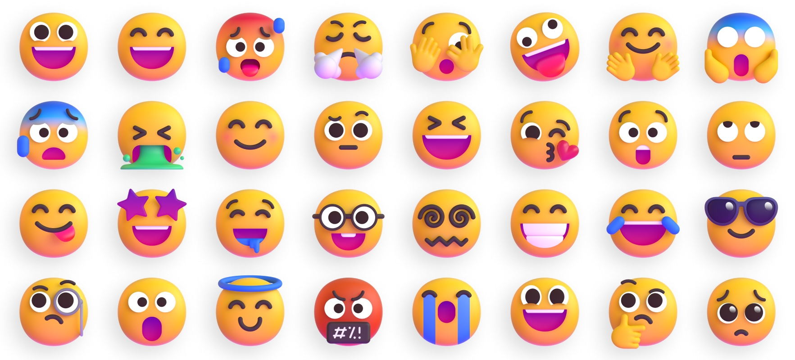

<div align="center">


# Fluent Emoji

**Microsoft's Fluent emojis in 3D, animated, color, flat and high contrast, all in one repo.**

[Browse the showcase](https://malte9799.github.io/fluent-emoji/) · [Usage](#usage) · [Credits](#credits)

</div>



## What's inside

- 1,500+ emojis, each in up to five styles: `3d`, `animated`, `color`, `flat`, `high_contrast`
- Skin tone variants where the emoji supports them
- `Emojis/metadata.json` with the glyph, group, keywords and unicode sequences for every emoji
- A showcase page (`index.html`) to search, preview, copy and download

The repo is rebuilt every Sunday by a GitHub Action that merges the two source repos below.

## Usage

### Custom element

```html
<script src="https://malte9799.github.io/fluent-emoji/fluent-emoji.js"></script>

<fluent-emoji name="grinning_face-3d" width="64"></fluent-emoji>
<fluent-emoji name="thumbs_up-animated-medium" width="64"></fluent-emoji>
```

The name is `{emoji}-{style}`, followed by `-{skintone}` for emojis with skin tones
(`default`, `light`, `medium_light`, `medium`, `medium_dark`, `dark`).
Other attributes (`width`, `style`, `loading`, `alt`, …) are passed to the generated ``.

### Direct URLs

```
Emojis/{emoji}/{style}.{png|svg}                # no skin tones
Emojis/{emoji}/{style}/{skintone}.{png|svg}     # with skin tones
```

`3d` and `animated` are PNGs; `color`, `flat` and `high_contrast` are SVGs.

## Credits

The artwork is not ours. This repo only combines and organises it:

| Source | Used for |
| --- | --- |
| [microsoft/fluentui-emoji](https://github.com/microsoft/fluentui-emoji) | 3D, color, flat and high contrast emojis and metadata |
| [Tarikul-Islam-Anik/Animated-Fluent-Emojis](https://github.com/Tarikul-Islam-Anik/Animated-Fluent-Emojis) | Animated emojis and the banner above |

See [`license`](license) for licensing details.
